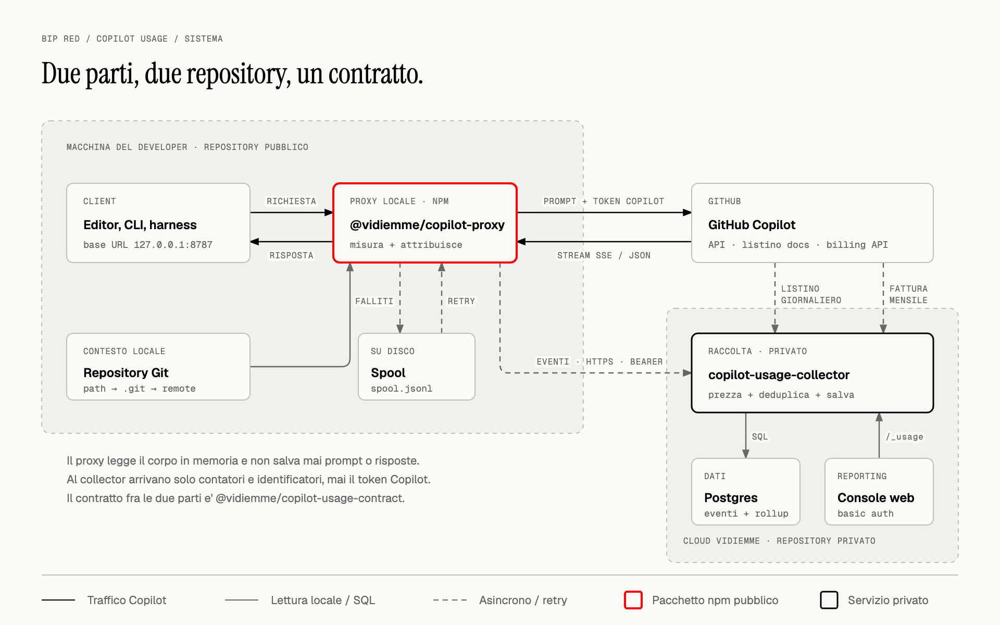
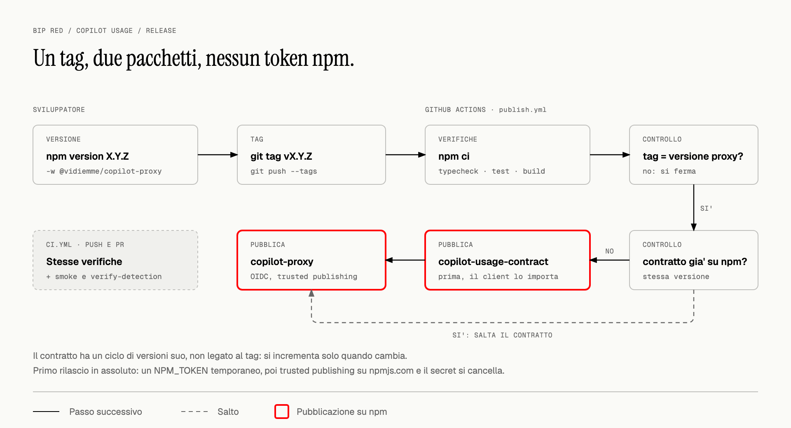

# copilot-usage

Misura il consumo di token di GitHub Copilot e lo attribuisce **al progetto**, oltre che
alla persona.

Le statistiche native di Copilot sono verticali per utente: non dicono quanto costa un cliente
o una commessa quando piu' developer lavorano su piu' progetti. Un proxy locale si mette in
mezzo al traffico, legge i contatori di token che il modello restituisce, riconosce il
repository su cui si sta lavorando e manda i contatori a un servizio centrale, che li converte
in costo con il listino GitHub e li conserva.



[Sorgente HTML del diagramma](packages/client/docs/diagrams/system.html)

## Dove trovare cosa

| Documento | Per chi | Cosa contiene |
| --- | --- | --- |
| Questo README | chi sviluppa o rilascia il proxy | architettura, scelte di fondo, sviluppo, release |
| [README del client](packages/client/README.md), anche su npm | developer e chi fa il rollout | installazione, editor e CLI, attribuzione, privacy, diagnostica |
| [README del contratto](packages/shared/README.md), anche su npm | chi implementa un collector | protocollo, campi dell'evento, risposte, compatibilita' |
| README di `copilot-usage-collector`, repository privato | chi gestisce il servizio | deploy, configurazione, listino, reporting, schema, riconciliazione |

Ogni argomento ha **un solo documento di riferimento**; gli altri lo riassumono e ci rimandano.

## Le due parti

| | `@vidiemme/copilot-proxy` | `copilot-usage-collector` |
| --- | --- | --- |
| Dove sta | **questo repository**, pubblico su npm | repository separato, privato |
| Dove gira | postazione del developer | cloud, sempre disponibile |
| Cosa fa | proxy trasparente, estrae i contatori, riconosce progetto e developer | applica il listino, deduplica, persiste, espone il reporting |
| Cosa gli serve | il token di ingest | accesso al database |
| Cosa **non** ha | credenziali del database, listino prezzi | token Copilot, prompt, path locali |

Il terzo pacchetto, [`@vidiemme/copilot-usage-contract`](packages/shared/README.md), e' il
contratto sul filo: l'unica cosa che le due parti condividono.

Il taglio non e' arbitrario:

- **il listino sta sul server**, perche' aggiornarlo non deve richiedere di ridistribuire n
  postazioni: il client manda contatori grezzi e, quando GitHub lo scrive nella risposta,
  l'addebito della richiesta, che il server preferisce al listino;
- **il database sta dietro il server**, perche' le sue credenziali non devono finire su n
  macchine;
- **il traffico Copilot non passa dal cloud**: il proxy parla direttamente con
  `api.githubcopilot.com`, e al collector arrivano solo eventi di consumo.

E' anche il motivo per cui i repository sono due: qui non c'e' niente da tenere riservato, e
un pacchetto che i developer installano con `npx` e' piu' credibile se il codice si puo'
leggere. Il collector custodisce invece listino, schema e dati di costo aziendali.

Il proxy non dipende mai dalla raggiungibilita' del collector: se il collector e' giu', la rete
manca o il token e' stato ruotato, le richieste Copilot continuano a passare e gli eventi
aspettano in uno spool su disco. La chiave `requestId` rende innocui i rinvii. I dettagli,
compresi i limiti, sono nel [README del client](packages/client/README.md#collector-non-disponibile).

> **Modello di fiducia.** Il token di ingest e' un segreto condiviso a livello di
> organizzazione: chiunque lo possieda puo' dichiarare qualsiasi developer e progetto. E'
> contabilita' analitica interna, **non** un confine di sicurezza. Per un'attribuzione non
> ripudiabile servirebbero credenziali per postazione e un'identita' verificata lato server.

## Cosa viene misurato

| Client | Misurato | Come arriva al proxy |
| --- | --- | --- |
| Copilot Chat in VS Code e derivati (Insiders, VSCodium, Cursor, Windsurf, Antigravity) | si' | impostazioni utente `overrideCapiUrl`, scritte da `setup --vscode` |
| Copilot CLI e sessioni "Copilot CLI" in VS Code | si' | variabile `COPILOT_API_URL`, impostata da `setup --vscode` |
| CLI e harness con base URL configurabile | si', se parlano un protocollo che l'upstream espone | base URL `http://127.0.0.1:8787`, configurata a mano |
| Harness tramite un proxy intermedio (`copilot-api`, LiteLLM, ...) | si', se il proxy intermedio permette di cambiare l'URL di Copilot | URL del provider Copilot nel proxy intermedio |
| JetBrains, Eclipse, Xcode, Visual Studio | **no** | il Copilot Language Server accetta solo un forward proxy: servirebbe decifrare il TLS |
| Code completions | non serve | endpoint diverso, non consumano AI credits |

Il proxy **non traduce i protocolli**. Un client Anthropic come Claude Code raggiunge Copilot
solo se l'upstream espone l'API Messages, o tramite un proxy intermedio che traduce; in quel
caso il proxy di misura va messo dopo il traduttore. Vedi
[Harness con proxy intermedio](packages/client/README.md#harness-con-proxy-intermedio).

Le impostazioni di override di Copilot Chat sono **di debug, non documentate**: possono
sparire con un aggiornamento dell'estensione. `copilot-proxy doctor` segnala l'assenza di
traffico da oltre 24 ore, che e' il sintomo tipico.

L'unica alternativa per i client non coperti sarebbe un forward proxy con intercettazione TLS
e una CA aziendale sulle macchine. **Non e' implementato**, e in Italia ricadrebbe nell'art. 4
dello Statuto dei Lavoratori: andrebbe concordato con HR e legale e comunicato ai developer.

## Come funziona, in breve

**Instradamento.** Ogni famiglia di client ha la sua leva per cambiare l'URL di Copilot, e
ignora quella degli altri: per questo `setup --vscode` scrive sia le impostazioni dell'editor
sia `COPILOT_API_URL`. Diagramma e dettagli:
[Configurare editor, CLI e harness](packages/client/README.md#configurare-editor-cli-e-harness).

**Misura.** Il proxy inoltra la richiesta cosi' com'e' e legge una copia dello stream di
risposta. Riconosce tre formati senza configurazione: Anthropic Messages, OpenAI Chat
Completions e OpenAI Responses. Per le Chat Completions in streaming aggiunge
`stream_options: { include_usage: true }` **solo se il client non l'ha gia' specificato**:
senza, l'upstream non restituirebbe contatori. Prompt e risposte non vengono mai salvati.

**Attribuzione del progetto.** Prima i segnali espliciti, poi i path:

| Priorita' | Segnale | Sorgente |
| --- | --- | --- |
| 1 | prefisso `/p/<progetto>` nella base URL | `path` |
| 2 | header `X-Project-Id` | `header` |
| 3 | username di `Proxy-Authorization` | `proxy-auth` |
| 4 | mappa `ATTRIBUTION_TOKENS` | `token` |
| 5 | path dei repository locali citati nella richiesta | `workspace` |
| 6 | ultimo progetto della stessa sessione, entro 30 minuti | `session` |
| 7 | nessun segnale: `unassigned` | `fallback` |

Il rilevamento dai path (5) e' il caso normale per VS Code e non richiede configurazione per
repository: l'identita' del progetto e' il percorso del remote Git (`acme/web/portal`), non
il nome della cartella. Funziona solo perche' il proxy gira **sulla stessa macchina** dei
repository: un proxy condiviso vedrebbe path che non puo' risolvere.

**Attribuzione del developer.** Prefisso `/u/`, header `X-Developer-Id`, mappa
`ATTRIBUTION_TOKENS`, oppure uno pseudonimo: hash con salt del campo stabile del token Copilot,
identico su ogni postazione della stessa persona. Dettagli:
[Attribuzione al progetto e al developer](packages/client/README.md#attribuzione-al-progetto-e-al-developer).

**Consegna.** Gli eventi vanno al collector in batch, ogni 5 secondi o a 100 eventi. Il
formato e le risposte sono nel [contratto](packages/shared/README.md#il-protocollo).

## Rollout in Vidiemme

Il collector e' attivo su **`https://copilot-collector.swarm.vidiemme.it`**, ed e' gia' il
default del pacchetto ([`src/defaults.ts`](packages/client/src/defaults.ts)) insieme al salt
degli pseudonimi. A ogni postazione serve solo il token di ingest, da chiedere a chi
amministra il servizio:

```bash
npm install -g @vidiemme/copilot-proxy@latest
copilot-proxy setup --vscode --autostart     # chiede il token in modo nascosto
```

Per un rollout non interattivo (MDM, script) il token si passa con `COLLECTOR_TOKEN`
nell'ambiente; non esiste un'opzione `--token`, di proposito. Installazione, aggiornamento e
diagnostica sono nel [README del client](packages/client/README.md#installazione-rapida).

Per verificare il rollout:

```bash
# 1. sulla postazione: proxy in ascolto, eventi misurati e consegnati
copilot-proxy status
copilot-proxy doctor

# 2. sul collector, dopo qualche prompt: il reporting chiede la basic auth dell'ingress
curl -u <utente> "https://copilot-collector.swarm.vidiemme.it/_usage/summary?groupBy=developer"

# 3. nessun modello deve restare fuori listino
curl -u <utente> https://copilot-collector.swarm.vidiemme.it/_usage/unknown-models
```

Se il punto 1 misura eventi ma il punto 2 resta vuoto, lo spool sulla postazione cresce e i
log del proxy dicono il motivo (`collector irraggiungibile`, `collector ha rifiutato gli
eventi`). Molto traffico con sorgente `fallback` significa che `WORKSPACE_ROOTS` non copre le
cartelle di lavoro reali.

## Sviluppo

Monorepo npm con due pacchetti. Serve Node >= 22.19 (richiesto da Undici 8).

```
packages/
  client/   @vidiemme/copilot-proxy           il proxy, CLI compreso
    src/        proxy/, usage/ (parser), collector/ (forwarder e spool), attribuzione, setup
    scripts/    smoke, verify-detection, verify-e2e
    docs/diagrams/   sorgenti HTML e PNG dei diagrammi
  shared/   @vidiemme/copilot-usage-contract  tipi e validazione del protocollo
scripts/render-diagrams.sh                    rigenera i PNG dei diagrammi
```

```bash
npm install
cp packages/client/.env.example packages/client/.env    # punta il proxy a un collector locale
npm run dev
```

Il `.env` serve **solo** allo sviluppo del proxy: le postazioni non ne hanno uno, e sotto
`npx` non viene letto nessun `.env` dalla working directory. In sviluppo lo carica
`node --env-file-if-exists`, non il codice, cosi' i due percorsi restano distinti.

| Porta | Cosa |
| --- | --- |
| `8787` | il proxy (`copilot-proxy`), sulla postazione |
| `8080` | il collector, quando lo avvii in locale dal suo repository |
| `5433` | il Postgres usa e getta del collector, in locale |

```bash
npm test                  # contratto, forwarder, parser usage, attribuzione, config, proxy end-to-end
npm run typecheck
npm run build
npm run smoke             # proxy reale contro un upstream finto, senza collector
npm run verify-detection  # rilevamento del progetto, con un collector finto
npm run verify-e2e        # client -> collector -> Postgres (richiede il collector avviato)
```

`smoke` e `verify-detection` girano ovunque; `verify-e2e` attraversa tutto lo stack e richiede
il collector in esecuzione. `UPSTREAM_BASE_URL` puo' puntare a `https://api.githubcopilot.com`
oppure a un traduttore gia' in uso (es. `copilot-api` su `http://127.0.0.1:4141`).

Ogni modifica al contratto deve restare retrocompatibile con i proxy gia' installati, che si
aggiornano quando vogliono: le regole sono in
[Versionamento e compatibilita'](packages/shared/README.md#versionamento-e-compatibilita).

## Release



[Sorgente HTML del diagramma](packages/client/docs/diagrams/release.html)

```bash
npm version X.Y.Z -w @vidiemme/copilot-proxy   # e il contratto, solo se e' cambiato
git tag vX.Y.Z && git push --tags
```

[`publish.yml`](.github/workflows/publish.yml) esegue typecheck, test e build, verifica che il
tag corrisponda alla versione del proxy, pubblica il contratto se la sua versione non e' gia'
sul registry e poi il proxy. [`ci.yml`](.github/workflows/ci.yml) esegue le stesse verifiche,
piu' `smoke` e `verify-detection`, a ogni push su `main` e su ogni pull request.

Il contratto va per primo perche' il client ne importa a runtime `MAX_EVENTS_PER_BATCH` e
`totalInputTokens`. Ha un ciclo di versioni suo, non legato al tag. Entrambi i pacchetti hanno
`publishConfig.access: public`, altrimenti npm tratterebbe lo scope come privato.

L'autenticazione usa **trusted publishing**: GitHub Actions si autentica su npm via OIDC, con
credenziali usa e getta, senza token npm da custodire. Va configurato su npmjs.com per
**entrambi** i pacchetti, indicando organizzazione, repository e `publish.yml`. Il campo
`repository` di `package.json` deve combaciare con il repository GitHub. OIDC funziona con
GitHub Actions, GitLab.com e CircleCI, non con GitLab self-hosted.

**Primo rilascio in assoluto.** Il trusted publisher si configura dalle impostazioni di un
pacchetto, che non esistono finche' il pacchetto non e' sul registry:

1. su npmjs.com crea un **granular access token** in scrittura sullo scope `@vidiemme`, con
   scadenza breve;
2. mettilo nel secret `NPM_TOKEN` del repository GitHub;
3. spingi il tag: la CI pubblica entrambi i pacchetti con il token;
4. configura il trusted publishing sui due pacchetti appena creati;
5. **cancella il secret e revoca il token**. Da qui in avanti la CI usa OIDC.

In locale, se serve pubblicare a mano: `npm run release` (typecheck, test, contratto se la
versione e' nuova, poi proxy).

## Diagrammi

I diagrammi stanno in [`packages/client/docs/diagrams/`](packages/client/docs/diagrams/):
l'HTML e' il sorgente, il PNG la resa a 2x che README e npm mostrano. Sono creati con
`diagram-design`, profilo `bip-red` ([`.diagram-design`](.diagram-design)).

| Diagramma | Mostra | Usato in |
| --- | --- | --- |
| `system` | le due parti e quali dati passano su ogni freccia | questo README |
| `release` | il flusso di pubblicazione su npm | questo README |
| `architecture` | proxy locale, upstream, spool e collector | client |
| `lifecycle` | ciclo di una richiesta, dall'editor al collector | client |
| `routing` | come ogni famiglia di client arriva al proxy | client |
| `attribution` | precedenza dell'attribuzione del progetto | client |
| `identity` | identita' del developer e pseudonimo | client |
| `harness` | disposizione con un proxy intermedio, e ripiego | client |
| `delivery` | coda, spool, ritentativi e perdite | client |

Dopo aver modificato un HTML:

```bash
scripts/render-diagrams.sh packages/client/docs/diagrams/*.html
```

Lo script usa Chrome in modalita' headless (`CHROME=/percorso/del/binario` per sceglierne un
altro). Il README del client punta ai PNG su `raw.githubusercontent.com`, perche' npm non
risolve i path relativi: un diagramma aggiornato compare li' dopo il push su `main`.
