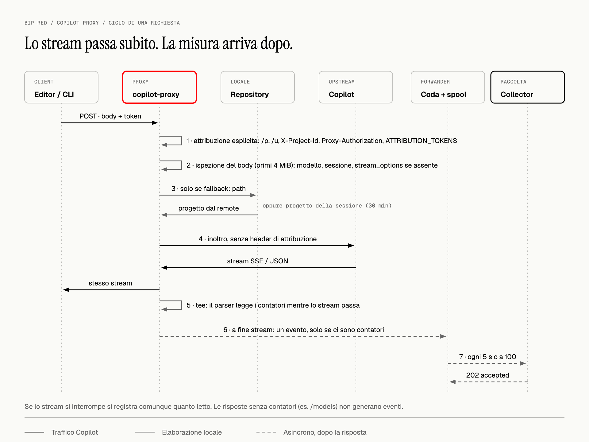
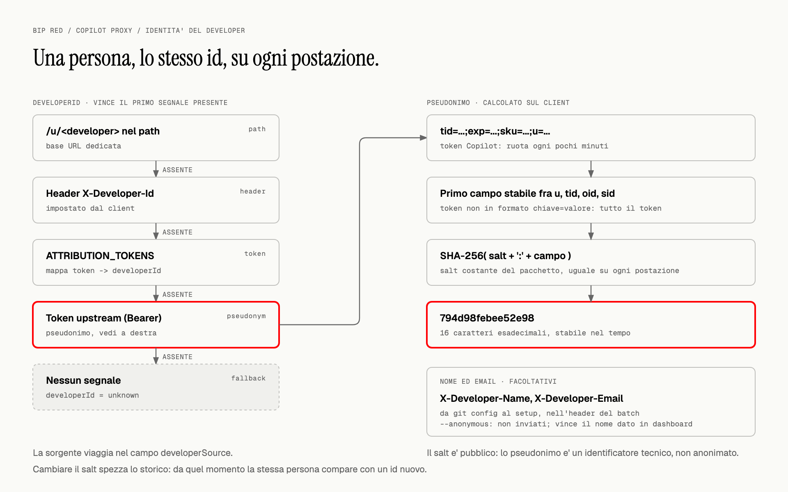
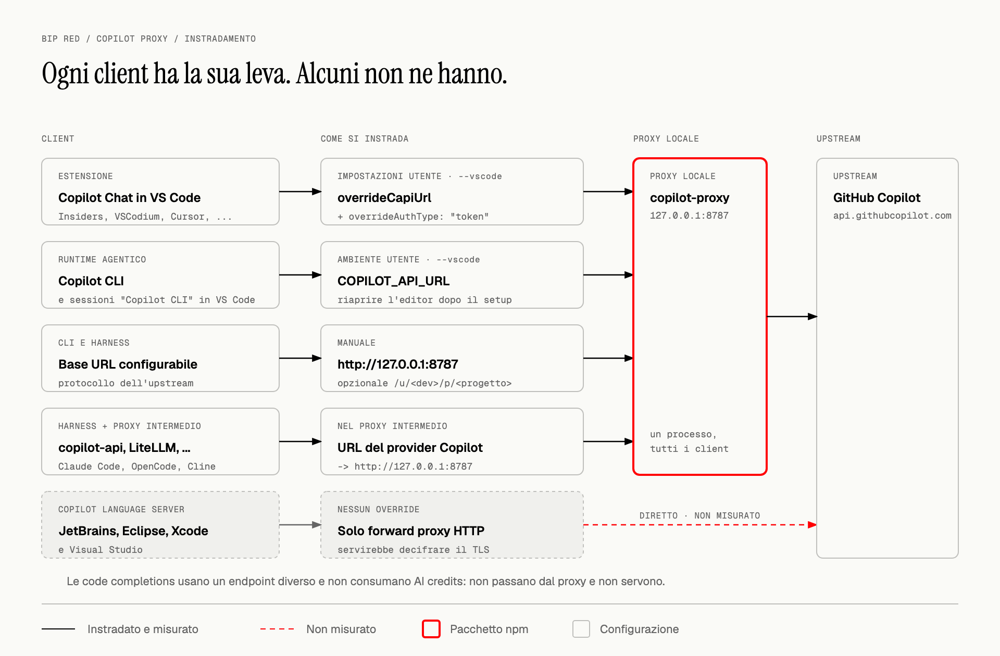
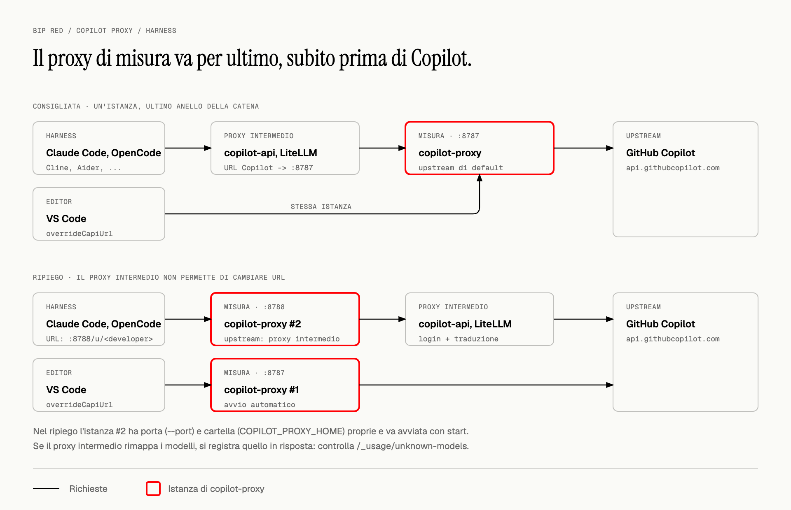
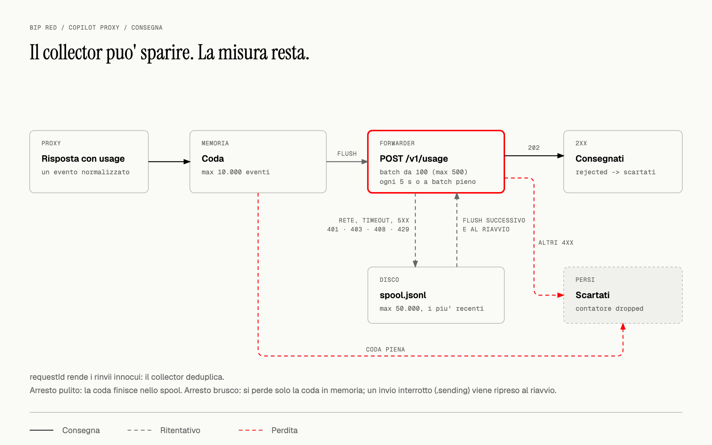

# @vidiemme/copilot-proxy

[](https://www.npmjs.com/package/@vidiemme/copilot-proxy)
[](https://nodejs.org/)
[](https://github.com/vidiemme/copilot-usage/blob/main/packages/client/LICENSE)

**Misura i token di GitHub Copilot e attribuiscili al progetto, non solo alla persona.**

Un proxy locale per chat e agenti: inoltra le richieste a Copilot, estrae i contatori
dalle risposte e invia gli eventi a un collector centrale. Il collector applica il
listino e conserva i dati, permettendo di aggregare il consumo di un progetto tra
piu' developer.

Non e' un'estensione da installare nel marketplace, non fornisce un abbonamento
Copilot e non calcola prezzi sul client. Serve un **collector compatibile**:
il pacchetto contiene i default aziendali Vidiemme, ma puo' usare un altro endpoint.

## Indice

- [Requisiti e compatibilita'](#requisiti-e-compatibilita)
- [Installazione rapida](#installazione-rapida)
- [Come funziona](#come-funziona)
- [Attribuzione al progetto e al developer](#attribuzione-al-progetto-e-al-developer)
- [Configurare editor, CLI e harness](#configurare-editor-cli-e-harness)
- [Comandi e configurazione](#comandi-e-configurazione)
- [Dati, privacy e limiti](#dati-privacy-e-limiti)
- [Diagnostica](#diagnostica)
- [Aggiornamento e rimozione](#aggiornamento-e-rimozione)
- [Sorgenti e licenza](#sorgenti-e-licenza)

## Requisiti e compatibilita'

- **Node.js >= 22.19** (richiesto da Undici 8) e npm.
- Accesso a GitHub Copilot gia' funzionante nel client utilizzato.
- URL di ingest e token del collector. Per Vidiemme chiedi il token a chi
  amministra il servizio; non e' il token GitHub o Copilot.
- Per il rilevamento automatico, il proxy deve poter leggere i repository locali
  e i loro metadati Git sulla macchina che contiene i path nelle richieste.

| Ambiente | Supporto |
| --- | --- |
| VS Code, Insiders, VSCodium, Cursor, Windsurf, Antigravity | Configurazione automatica delle impostazioni utente per l'estensione GitHub Copilot, dove presente. Non misura gli altri provider AI dell'editor. |
| CLI e harness con base URL o header configurabili | Integrazione manuale; il protocollo e l'autenticazione devono essere compatibili con l'upstream. |
| Proxy intermedi verso Copilot | Supportati se permettono di cambiare l'URL del provider Copilot. |
| JetBrains / Android Studio, Eclipse, Xcode, Visual Studio | Non supportati: nessuna intercettazione TLS / `CONNECT` implementata. |
| macOS | Avvio automatico tramite LaunchAgent `launchd` dell'utente. |
| Linux | Avvio automatico tramite servizio utente `systemd`. |
| Windows | Avvio automatico tramite `copilot-proxy.cmd` nella cartella Esecuzione automatica dell'utente, senza diritti di amministratore: avvia un supervisore nascosto che rilancia il proxy se termina. |

> Le impostazioni di override di Copilot sono opzioni di **debug non supportate**:
> possono cambiare con gli aggiornamenti dell'estensione. Verifica periodicamente
> il traffico con `status` e `doctor`. Non vengono misurate le code completions
> instradate su endpoint diversi da quello di chat.

## Installazione rapida

### Servizio persistente (consigliato)

```bash
npm install -g @vidiemme/copilot-proxy@latest
copilot-proxy setup --vscode --autostart
```

Il setup:

1. chiede il **token di raccolta** senza mostrarlo nel terminale;
2. propone la porta locale `8787` e controlla che sia disponibile;
3. propone nome ed email da `git config`, per riconoscersi nella dashboard;
4. salva la configurazione e aggiorna gli editor installati con `--vscode`;
5. registra e avvia il servizio dell'utente con `--autostart`.

**Riavvia gli editor** dopo il setup. Poi invia una richiesta a Copilot Chat e verifica:

```bash
copilot-proxy status
copilot-proxy doctor
```

Per non inviare nome, email e hostname aggiungi `--anonymous` al setup. Questo
mantiene lo pseudonimo tecnico: non rende anonimo l'intero evento.

L'installazione globale mantiene stabile il percorso del servizio. Il setup con
`npx --autostart` e' possibile, ma il servizio punterebbe alla cache npm:
svuotarla potrebbe impedirne il riavvio. Anche eliminare una versione Node
gestita da nvm, fnm, mise o simili richiede di registrare nuovamente il servizio.

### Senza installazione globale o senza avvio automatico

```bash
npx @vidiemme/copilot-proxy@latest setup --vscode
npx @vidiemme/copilot-proxy@latest start
```

`start` resta in primo piano: lascia il terminale aperto e usa `Ctrl+C` per fermarlo.
Con questa modalita' il proxy va avviato prima di usare gli editor configurati.

### Un collector diverso da quello aziendale

```bash
copilot-proxy setup --vscode --autostart \
  --collector-url https://collector.example.com/v1/usage \
  --workspace-roots /percorso/ai/repository
```

Il collector deve implementare il contratto pubblico
[`@vidiemme/copilot-usage-contract`](https://www.npmjs.com/package/@vidiemme/copilot-usage-contract).
Non e' incluso in questo pacchetto. Il default Vidiemme e'
`https://copilot-collector.swarm.vidiemme.it/v1/usage`; la ricerca dei repository
e' limitata per default alla home dell'utente.

Per un rollout non interattivo fornisci `COLLECTOR_TOKEN` tramite l'ambiente di
esecuzione o un secret manager. **Non esiste un'opzione `--token`**: evita di
incollare segreti nei comandi, nella cronologia della shell o nei file versionati.

## Come funziona


[Sorgente HTML del diagramma](https://github.com/vidiemme/copilot-usage/blob/main/packages/client/docs/diagrams/architecture.html)

1. L'editor o il CLI invia la richiesta al proxy, in ascolto su `127.0.0.1:8787`.
2. Il proxy determina progetto e developer e inoltra la richiesta all'upstream,
   per default `https://api.githubcopilot.com`.
3. La risposta viene inoltrata al client mentre un parser estrae l'usage.
4. I contatori normalizzati vengono accodati e inviati al collector in batch,
   insieme all'addebito che GitHub dichiara in `copilot_usage.total_nano_aiu`.
   Il proxy non calcola prezzi: il collector usa l'addebito quando c'e', altrimenti
   applica il listino, e si occupa di deduplicazione e persistenza.

Il token Copilot e la conversazione vanno all'upstream, **non al collector**.
Il proxy non effettua login o rinnovo delle credenziali Copilot: se ne occupa
il client o il proxy intermedio gia' utilizzato.

### Ciclo di vita di una richiesta



[Sorgente HTML del diagramma](https://github.com/vidiemme/copilot-usage/blob/main/packages/client/docs/diagrams/lifecycle.html)

La risposta arriva al client **mentre** passa: il parser legge una copia dello stream e non
lo rallenta. L'evento nasce solo a fine stream, e solo se la risposta conteneva contatori.
Il formato dell'evento e le risposte del collector sono specificati nel
[contratto](https://github.com/vidiemme/copilot-usage/tree/main/packages/shared#readme).

### Protocolli e contatori

| Formato di risposta | Origine dei contatori |
| --- | --- |
| Anthropic Messages | `message_start` e `message_delta`, inclusi cache read e cache write. |
| OpenAI / Copilot Chat Completions | Oggetto `usage` nella risposta JSON o nel chunk finale dello stream. |
| OpenAI Responses API | `response.usage`, anche negli eventi `response.completed`, `response.incomplete` e `response.failed`. |

Per le richieste streaming a `/chat/completions`, il proxy aggiunge
`stream_options: { "include_usage": true }` **solo se `stream_options` e' assente**.
Se il client lo specifica gia', deve richiedere l'usage correttamente.
La Responses API non riceve questo parametro.

Ogni evento distingue `inputTokens`, `cachedInputTokens`, `cacheWriteTokens` e
`outputTokens`, evitando doppi conteggi quando i dettagli del provider lo permettono.
Le risposte senza contatori, per esempio le chiamate a `/models`, non generano eventi.
Se uno stream si interrompe vengono registrati i contatori disponibili: il risultato
puo' essere parziale.

### Hydra Fusion

L'evento contiene `hydraFusion`: `true` indica Fusion, `false` una selezione diretta
riconoscibile e `null` significa che il routing non e' determinabile. Il campo `model`
continua a indicare il modello fisico e non basta, da solo, a stabilire se Fusion l'abbia
scelto.

Per Copilot CLI e le sessioni agentiche in VS Code il proxy legge localmente i record
`session.usage_record` e li abbina all'header upstream `x-copilot-service-request-id`
tramite `serviceRequestId`, usato anche come `requestId` dell'evento. Se l'header Copilot
manca, usa `x-request-id`; per gli altri client la precedenza non cambia.
Il blocco `usage.fusion.syntheticModel` identifica Fusion; in assenza
del blocco, una selezione esplicita di un modello fisico identico a quello della chiamata
indica una selezione diretta. Un identificatore sintetico Fusion riconosciuto nella richiesta
viene rilevato anche senza log. Per la chat VS Code ricaricata dallo storico, `true` deriva
dal modello Fusion selezionato; `false` richiede anche un modello risolto corrispondente.

Il record CLI puo' arrivare dopo la risposta: per un massimo di 15 secondi il proxy legge
le righe nuove dei log recenti (alla prima lettura, o dopo una crescita superiore a 4 MiB,
solo gli ultimi 4 MiB) e, se necessario, invia un aggiornamento con lo stesso
`requestId`. Il collector aggiorna il solo flag, senza ricontare token o costi; per questo va
aggiornato prima dei proxy, altrimenti scarta l'aggiornamento come duplicato. Un evento
scartato per coda piena non riceve aggiornamenti. Mancanza di
ID, log, permessi, metadati o modello selezionato affidabile lascia `null`; la chat VS Code
dal vivo e gli altri harness non vengono dedotti dal solo modello fisico. Il proxy non
salva ne' trasmette i contenuti dei log, soltanto il flag.

## Attribuzione al progetto e al developer


[Sorgente HTML del diagramma](https://github.com/vidiemme/copilot-usage/blob/main/packages/client/docs/diagrams/attribution.html)

### Progetto

Il progetto viene risolto con questa precedenza. I segnali 1-4 sono espliciti e vincono
sempre; il rilevamento dai path parte solo se nessuno di loro e' presente.

| Priorita' | Segnale | `projectSource` |
| --- | --- | --- |
| 1 | Prefisso URL `/p/<progetto>` | `path` |
| 2 | Header `X-Project-Id` (nome personalizzabile) | `header` |
| 3 | Username di `Proxy-Authorization: Basic ...`, se inviato dal client | `proxy-auth` |
| 4 | Mappa statica `ATTRIBUTION_TOKENS` | `token` |
| 5 | Path locali citati nella richiesta, dentro `WORKSPACE_ROOTS` | `workspace` |
| 6 | Ultimo progetto rilevato per la stessa sessione, entro il TTL | `session` |
| 7 | `UNASSIGNED_PROJECT`, per default `unassigned` | `fallback` |

Il rilevamento risale dai path al marker piu' vicino (`.git`, `.hg` o `.svn`).
Tra piu' progetti prevale quello con piu' path candidati distinti.
Per Git l'identita' deriva dal remote `origin`, poi `upstream`, poi dal primo
disponibile, non dal nome scelto per la cartella di clone:

| Remote | ID progetto |
| --- | --- |
| `git@github.com:acme/portal.git` | `acme/portal` |
| `https://gitlab.com/acme/web/portal.git` | `acme/web/portal` |
| Nessun remote utilizzabile, oppure progetto non Git | Nome normalizzato della cartella |

Sono gestiti anche worktree e submodule Git. La cache path/repository dura 10 minuti.

I path dentro cartelle nascoste o di dati applicativi subito sotto un root
(`~/.copilot`, `~/.claude`, `~/.cursor`, `~/Library`, `AppData`) non contano:
li' ci sono i clone di plugin e skill, che quando una skill viene caricata
verrebbero citati piu' del progetto reale. Fanno eccezione i worktree Git
(`.git` come file), che gli agenti creano per esempio in `~/.codex/worktrees`.
L'ID derivato dal remote non include l'host: percorsi uguali su host Git diversi
possono quindi coincidere.

Le richieste senza path riutilizzano il progetto dell'ultima rilevazione della
sessione per **30 minuti**. La sessione usa gli header `vscode-sessionid`,
`x-vscode-session-id`, `x-session-id`, oppure l'ID estratto da `metadata.user_id`.
In loro assenza la chiave e' il developer: in quel caso progetti paralleli
possono condividere il fallback. Il rilevamento ispeziona al massimo i primi
4 MiB del corpo della richiesta.

### Developer



[Sorgente HTML del diagramma](https://github.com/vidiemme/copilot-usage/blob/main/packages/client/docs/diagrams/identity.html)

| Priorita' | Segnale | `developerSource` |
| --- | --- | --- |
| 1 | Prefisso URL `/u/<developer>` | `path` |
| 2 | Header `X-Developer-Id` | `header` |
| 3 | Mappa statica `ATTRIBUTION_TOKENS` | `token` |
| 4 | Pseudonimo del token upstream | `pseudonym` |
| 5 | Nessun segnale: `unknown` | `fallback` |

Lo pseudonimo e' un hash SHA-256 con salt, troncato a 16 caratteri esadecimali, del
**campo stabile** del token Copilot: il primo presente fra `u`, `tid`, `oid` e `sid`. Il
token ruota ogni pochi minuti e l'hash dell'intero token creerebbe una persona nuova a ogni
rotazione. Un token che non e' nel formato `chiave=valore;...` viene usato per intero.

Il salt e' una costante del pacchetto e deve restare uguale su tutte le postazioni: e' cio'
che rende confrontabile la stessa persona fra macchine. Cambiarlo interrompe la continuita'
degli ID.

Nome ed email confermati al setup non entrano nell'evento: viaggiano negli header
`X-Developer-Name` e `X-Developer-Email` di ogni batch, e il collector non li usa se un
amministratore ha gia' assegnato un nome dalla dashboard.

## Configurare editor, CLI e harness



[Sorgente HTML del diagramma](https://github.com/vidiemme/copilot-usage/blob/main/packages/client/docs/diagrams/routing.html)

Ogni famiglia di client ha un meccanismo diverso per cambiare l'URL di Copilot, e ignora
quello degli altri. `setup --vscode` copre le prime due righe; le altre si configurano a mano.

### VS Code e derivati

`setup --vscode` imposta queste due chiavi nelle **impostazioni utente**:

```json
{
  "github.copilot.advanced.debug.overrideCapiUrl": "http://127.0.0.1:8787",
  "github.copilot.advanced.debug.overrideAuthType": "token"
}
```

`"token"` e' una modalita' di autenticazione, non un segreto da sostituire.
Non serve un'impostazione per repository. Non impostare `overrideProxyUrl`:
riguarda un altro endpoint, quello delle code completions.

Il setup salva un backup con suffisso `.bak` prima di modificare un file esistente.
Aggiunge o aggiorna solo le due chiavi: commenti, virgole finali e rientro del
resto del file restano com'erano. Se il file non e' JSON valido nemmeno ammettendo
commenti, non lo tocca e stampa lo snippet da inserire manualmente. Poi riavvia l'editor.

### Copilot CLI e sessioni agentiche in VS Code

Copilot CLI e le sessioni "Copilot CLI" dentro VS Code girano nel runtime
agentico di Copilot (`copilot-runtime`), un processo separato che **ignora**
`overrideCapiUrl` e parla direttamente con GitHub. Si indirizza al proxy con la
variabile d'ambiente `COPILOT_API_URL`, che il runtime eredita dall'editor.

`setup --vscode` la imposta a livello di sessione utente, in modo persistente:

| Sistema | Dove |
| --- | --- |
| macOS | `launchctl setenv` + LaunchAgent `~/Library/LaunchAgents/com.vidiemme.copilot-proxy.env.plist` |
| Linux | `~/.config/environment.d/copilot-proxy.conf` |
| Windows | variabile utente (`setx`) |

Vale per le applicazioni avviate dopo il setup: **chiudi e riapri VS Code** (non
basta ricaricare la finestra) e i terminali. `doctor` verifica che sia impostata.
`uninstall` la rimuove, altrimenti senza proxy il runtime non raggiungerebbe Copilot.

### CLI: attribuzione esplicita

Per un client compatibile con l'upstream e con base URL configurabile:

```text
http://127.0.0.1:8787/p/acme-portal
http://127.0.0.1:8787/u/developer-id/p/acme-portal
```

Il client aggiunge il path API, per esempio `/chat/completions` o `/v1/messages`.
I prefissi `/u/` e `/p/` sono opzionali, accettati in qualsiasi ordine e rimossi
prima dell'inoltro. Gli ID espliciti accettano fino a 64 caratteri:
lettere, numeri, punti, trattini e underscore, con primo carattere alfanumerico.
Per un ID che rappresenta un remote con sottogruppi usa uno slug come `acme-portal`,
non slash aggiuntivi nel prefisso.

In alternativa invia gli header `X-Project-Id` e, se serve, `X-Developer-Id`.
Gli header di attribuzione e `Proxy-Authorization` non vengono inoltrati all'upstream.
Il supporto al formato Anthropic **non** traduce automaticamente i protocolli:
un client Anthropic richiede un upstream che esponga Messages, o un traduttore.

### Harness con proxy intermedio

Se usi Claude Code, Codex o altri harness tramite un traduttore/provider Copilot
(`copilot-api`, LiteLLM, ...), metti `copilot-proxy` **per ultimo**, subito prima di Copilot:



[Sorgente HTML del diagramma](https://github.com/vidiemme/copilot-usage/blob/main/packages/client/docs/diagrams/harness.html)

1. Nel proxy intermedio cambia l'URL del provider Copilot in `http://127.0.0.1:8787`,
   senza path aggiuntivi. Il nome dell'opzione dipende dallo strumento (`baseURL`,
   `api_base`, ...). Per **LiteLLM** lo fa `setup --litellm`: trova la config (dal
   processo in esecuzione, dai LaunchAgent o in `~/litellm/config.yaml` e simili;
   altrimenti `--litellm-config <file>`), imposta `api_base` sui modelli
   `github_copilot/...` conservando commenti e backup, e lascia stare gli altri
   provider. Va poi riavviato LiteLLM; `doctor` segnala le rotte che non passano dal proxy.
2. Lascia `UPSTREAM_BASE_URL` del proxy di misura al suo default Copilot. Se il proxy
   intermedio usava un host del piano (per esempio `api.business.githubcopilot.com`),
   metti quello in `UPSTREAM_BASE_URL`.
3. Il proxy intermedio continua a gestire login, rinnovo token e traduzione;
   `copilot-proxy` inoltra `Authorization` senza toccarlo.

In questa posizione il proxy vede richieste gia' in formato Copilot con il token vero: lo
pseudonimo coincide con quello del traffico VS Code della stessa persona e il modello
registrato e' quello fatturato. Il progetto si ricava dai path citati nei messaggi, finche'
il proxy intermedio ne conserva il contenuto; altrimenti dichiaralo con
`http://127.0.0.1:8787/p/<progetto>`. Nel reporting il traffico si distingue per
`clientName`, che e' lo user-agent del proxy intermedio.

**Ripiego**, se il proxy intermedio non permette di cambiare l'URL di Copilot: una seconda
istanza di `copilot-proxy` prima di lui, con `UPSTREAM_BASE_URL` puntato al proxy
intermedio, una porta (`--port`) e una cartella (`COPILOT_PROXY_HOME`) proprie, avviata con
`start` perche' l'avvio automatico gestisce una sola istanza. L'harness manda una chiave
fittizia, quindi il developer va dichiarato nell'URL (`http://127.0.0.1:8788/u/mario.rossi`);
se il proxy intermedio rimappa i modelli, controlla `/_usage/unknown-models` sul collector.

Se `copilot-proxy` non e' nella catena, quel consumo non viene misurato e si vede solo come
differenza fra la fattura GitHub e il costo misurato.

`copilot-proxy` e' un **reverse proxy HTTP**, non un forward proxy generico:
impostare soltanto `HTTP_PROXY` / `HTTPS_PROXY` non garantisce il funzionamento.

## Comandi e configurazione

Gli esempi usano il comando globale; in alternativa sostituisci `copilot-proxy`
con `npx @vidiemme/copilot-proxy@latest`.

| Comando | Funzione |
| --- | --- |
| `setup` | Crea la configurazione della postazione. |
| `start` | Avvia il proxy in primo piano (comando predefinito se non ne indichi uno). |
| `status` | Mostra versione installata e in esecuzione, instradamento di editor e Copilot CLI, contatori per client, spool e stato dell'aggiornamento automatico. |
| `doctor` | Controlla configurazione, cartelle, collector, editor (anche override commentati), `COPILOT_API_URL` e runtime da riavviare, spool e processo. |
| `reload [cartella]` | Carica nel collector lo storico delle sessioni gia' fatte: vedi [Caricare lo storico](#caricare-lo-storico). |
| `restart` | Riavvia il servizio automatico gia' registrato. |
| `uninstall` | Rimuove l'avvio automatico e `COPILOT_API_URL`; lascia configurazione e impostazioni editor. |
| `--version` | Mostra la versione del CLI. |
| `--help` | Mostra comandi e opzioni. |

### Opzioni di setup

| Opzione | Uso |
| --- | --- |
| `--vscode` | Configura VS Code e derivati installati, e `COPILOT_API_URL` per Copilot CLI e sessioni agentiche. |
| `--autostart` | Registra e avvia il servizio utente (launchd, systemd o Esecuzione automatica di Windows). |
| `--litellm` | Fa passare dal proxy i modelli `github_copilot/...` della config di LiteLLM (vedi [Harness con proxy intermedio](#harness-con-proxy-intermedio)). |
| `--litellm-config <file>` | Config di LiteLLM da usare, se non viene trovata da sola. |
| `--port <n>` | Porta locale, default `8787`. |
| `--workspace-roots <a,b>` | Directory assolute in cui risolvere i progetti. |
| `--collector-url <url>` | Endpoint di ingest, incluso il path `/v1/usage`. |
| `--upstream <url>` | Base URL upstream, default `https://api.githubcopilot.com`. |
| `--name <nome>`, `--email <email>` | Identita' facoltativa per la dashboard. |
| `--anonymous` | Non invia nome, email e hostname. |
| `--salt <valore>` | Sovrascrive il salt aziendale; mantienilo coerente nel team. |
| `--no-auto-update` | Disattiva l'[aggiornamento automatico](#aggiornamento-automatico); `--auto-update` lo riattiva. |
| `--force` | Ripete il setup partendo dal file esistente, token compreso. |

Per cambiare porta senza reinserire il token:

```bash
copilot-proxy setup --force --port 9000 --vscode --autostart
```

### Caricare lo storico

Il proxy misura da quando e' installato. Per il periodo precedente `reload`
rilegge le sessioni che gli strumenti salvano sulla macchina e le carica nel
collector con la stessa configurazione del `setup`:

```bash
copilot-proxy reload ~/Work --from 2026-10-01 --to 2026-10-31 --dry-run   # anteprima
copilot-proxy reload ~/Work --from 2026-10-01 --to 2026-10-31             # caricamento
```

| Opzione | Uso |
| --- | --- |
| `[cartella]` | Solo le sessioni avviate in progetti sotto questa cartella; default le cartelle di lavoro del setup. |
| `--from <data>`, `--to <data>` | Periodo, estremi compresi, in ora locale (`AAAA-MM-GG`). Senza, tutto lo storico disponibile. |
| `--dry-run` | Mostra progetti, chiamate e token che verrebbero caricati, senza inviare. |
| `--yes` | Salta la conferma; necessario quando non c'e' un terminale. |
| `--litellm-config <file>` | Config di LiteLLM con cui riconoscere le chiamate degli harness passate da Copilot, se non e' quella del setup. |
| `--agents-all` | Carica tutte le chiamate degli harness nel periodo, senza filtro sui modelli. |

| Sorgente | Dove | Precisione |
| --- | --- | --- |
| Copilot CLI e sessioni agentiche in VS Code | `~/.copilot/session-state` | Esatta: contatori di ogni chiamata. |
| Chat di Copilot in VS Code e derivati | `workspaceStorage/*/chatSessions` | Costo esatto, token stimati (sotto). |
| Claude Code | `~/.claude/projects` | Esatta, se passava da Copilot (sotto). |
| Cline, Roo Code, Kilo Code | `globalStorage/<estensione>/tasks`, `~/.cline/data/tasks` | Esatta, se passava da Copilot. |
| opencode | `~/.local/share/opencode` (`opencode.db` o `storage/`) | Esatta, se passava da Copilot. |

Gli harness di terze parti non registrano se una chiamata e' andata a Copilot o
a un altro provider. `reload` la carica quando il modello chiesto corrisponde a
una rotta `github_copilot/...` della config di LiteLLM (quella registrata da
`setup --litellm`, trovata sulla macchina o passata con `--litellm-config`), e la
prezza con il modello Copilot di quella rotta; con il provider `github-copilot`
di opencode e Cline la carica sempre. Le altre restano fuori e sono contate nel
riepilogo; se la config di allora era diversa, `--agents-all` con `--from`/`--to`
carica tutto il periodo. Dal momento del `setup --litellm` quelle chiamate sono
misurate dal vivo e `reload` le esclude.

Le chat di VS Code conservano per ogni richiesta i crediti addebitati, l'output
totale e il contesto dell'ultimo round, non la ripartizione fra i round. `reload`
la ricostruisce in modo che, prezzata con il listino del collector (letto da
`/v1/rates`), dia esattamente l'addebito: costi e output sono quelli reali,
la divisione fra cache letta e scritta e' una stima. Le richieste salvate senza
crediti, da versioni vecchie dell'estensione, vengono escluse e contate nel riepilogo.

Gli eventi caricati si riconoscono dal client `GitHubCopilotChat/reload`,
`copilot/reload`, `claude-code/reload`, `cline/reload` e `opencode/reload`. Il developer e' uno pseudonimo dell'email (il token Copilot
usato dal proxy qui non c'e'): con un nome configurato il collector lo unisce
al traffico dal vivo sotto lo stesso nome, in anonimo resta un developer a parte.

Il comando si puo' rilanciare: le chiavi degli eventi sono deterministiche e il
collector deduplica. **Non deduplica pero' le chat di VS Code con il traffico
gia' misurato dal proxy**, perche' non hanno un id in comune: se il proxy era
attivo nel periodo scelto, `reload` lo segnala dal log del proxy e suggerisce
il `--to` da usare. Per Copilot CLI, quando il log contiene `serviceRequestId`, la
chiave coincide con quella usata dal proxy quando l'upstream fornisce
`x-copilot-service-request-id`: un rinvio puo' aggiungere il flag Fusion all'evento
esistente. Se l'header manca, o per eventi misurati prima di questa correzione quando
i due header differivano, le chiavi potrebbero non coincidere: ricaricare il periodo
puo' duplicare le richieste gia' misurate. Se il log di avvio e' disponibile, `reload`
avverte quando il periodo CLI si sovrappone al proxy. Senza `serviceRequestId` si usa
una chiave locale, che non deduplica il traffico gia' misurato.

### File e variabili d'ambiente

Il file `config.json` usa le stesse chiavi delle variabili d'ambiente.
La precedenza di **`start`** e': opzioni CLI > ambiente non vuoto > file > default
del pacchetto. `start` accetta `--port`, `--log-level`, `--collector-url` e
`--workspace-roots`. Il setup salva le proprie opzioni: non e' un import
generico di tutte le variabili d'ambiente nel file.

| Chiave | Default / significato |
| --- | --- |
| `COLLECTOR_TOKEN` | Obbligatorio; token di ingest, salvato dal setup. |
| `COLLECTOR_URL` | Endpoint Vidiemme indicato sopra; HTTPS obbligatorio fuori da localhost. |
| `HOST`, `PORT` | `127.0.0.1`, `8787`. Mantieni il bind locale. |
| `UPSTREAM_BASE_URL` | `https://api.githubcopilot.com`. |
| `UPSTREAM_AUTH_TOKEN` | Assente; se impostato sostituisce il token inoltrato all'upstream. |
| `WORKSPACE_ROOTS` | Home utente; lista di directory separate da virgole. |
| `PROJECT_MARKERS` | `.git,.hg,.svn`. |
| `PROJECT_HEADER`, `UNASSIGNED_PROJECT` | `x-project-id`, `unassigned`. |
| `PROJECT_STICKY_TTL_MS` | `1800000` (30 minuti). |
| `DEVELOPER_ID_SALT` | Salt aziendale incluso nel pacchetto; non e' una credenziale segreta. |
| `DEVELOPER_NAME`, `DEVELOPER_EMAIL` | Facoltativi; il nome abilita l'invio dell'identita' al collector. |
| `COPILOT_HOME` | `~/.copilot`; la stessa cartella usata dalla CLI per `session-state`. Configurala anche nel file del proxy se il servizio automatico non eredita la variabile. |
| `ATTRIBUTION_TOKENS` | `{}`; oggetto JSON token -> `{ "projectId": "...", "developerId": "..." }`. Contiene credenziali: non versionarlo. |
| `FLUSH_INTERVAL_MS`, `FLUSH_MAX_BATCH` | `5000`, `100` (massimo 500 eventi per batch). |
| `COLLECTOR_TIMEOUT_MS` | `10000`. |
| `SPOOL_PATH` | `spool.jsonl` nella directory di configurazione. |
| `LOG_LEVEL` | `info`. |
| `AUTO_UPDATE` | `true`; `false` disattiva l'[aggiornamento automatico](#aggiornamento-automatico). |
| `TLS_KEY_PATH`, `TLS_CERT_PATH` | Assenti; impostali entrambi per abilitare HTTPS in ingresso. |

Quando e' configurato il nome del developer, il proxy include automaticamente l'hostname
del sistema nell'header `X-Device-Name`. Senza nome, anche con `--anonymous`, non lo invia.
Il collector lo registra su ogni evento e divide il costo per macchina, anche quando piu'
postazioni condividono lo stesso account Copilot e quindi lo stesso pseudonimo.

La directory di configurazione e':

- macOS/Linux: `~/.config/copilot-proxy`, oppure `$XDG_CONFIG_HOME/copilot-proxy`;
- Windows: `%APPDATA%/copilot-proxy`, quando `APPDATA` e' definita;
- tutte le piattaforme: `COPILOT_PROXY_HOME`, se impostata nell'ambiente,
  sostituisce l'intera directory.

Il setup crea la directory con permessi `0700` e il file con `0600` su sistemi POSIX.
Non condividere il file: contiene il token di raccolta.
Il servizio automatico legge il file, non eredita in generale l'ambiente della shell;
`COPILOT_PROXY_HOME` viene invece riportata nella definizione del servizio.
Per impostazioni persistenti del servizio usa il file di configurazione.

## Dati, privacy e limiti

**Non vengono persistiti prompt o risposte dal proxy.** Il corpo viene comunque
letto in memoria per inoltro, ispezione e attribuzione. Al collector arrivano:

- ID richiesta e timestamp, progetto e fonte dell'attribuzione;
- identita' del repository rilevato: host, gruppi, nome e URL del remote;
- pseudonimo/ID developer e sua fonte, user agent e ID sessione se disponibile;
- endpoint, modello, contatori di token, durata e indicazione streaming;
- flag `hydraFusion` quando il routing e' rilevabile;
- nome, email e hostname facoltativi, negli header di invio, salvo `--anonymous`.

Non vengono inviati al collector il token Copilot, i path di lavoro rilevati o il
contenuto della conversazione. Gli URL dei remote sono invece metadati inviati:
non inserirvi credenziali. Il collector ha una propria gestione dei dati e della
conservazione. Lo pseudonimo e' un identificatore tecnico, **non una garanzia
di anonimato**; il salt distribuito nel pacchetto e' pubblico.

Il token di ingest e' condiviso nell'organizzazione: chi lo possiede puo'
dichiarare progetto e developer. E' uno strumento di contabilita' analitica
interna, non un sistema di attribuzione non ripudiabile o una fattura ufficiale.

### Collector non disponibile



[Sorgente HTML del diagramma](https://github.com/vidiemme/copilot-usage/blob/main/packages/client/docs/diagrams/delivery.html)

La disponibilita' del collector non blocca le richieste Copilot. Errori di rete,
timeout, errori server e HTTP `401`, `403`, `408`, `429` fanno conservare gli eventi
in uno spool JSONL locale, ritentato ai flush successivi e al riavvio.
La deduplicazione richiede il collector compatibile e usa `requestId`.

La consegna e' **best effort, non senza perdite**:

- coda in memoria fino a 10.000 eventi; quelli nuovi in eccesso sono scartati;
- spool fino a 50.000 eventi, conservando i piu' recenti;
- gli altri errori HTTP 4xx sono definitivi e causano lo scarto del batch;
- gli eventi rifiutati singolarmente dal collector vengono segnalati nei log;
- un arresto improvviso puo' perdere gli eventi ancora soltanto in memoria;
- gli aggiornamenti del flag Fusion seguono la stessa coda e lo stesso spool, ma non
  contano come nuovi eventi in `recorded`, `delivered` e `dropped`.

Tieni sotto controllo spool, errori e contatore `dropped`. Il proxy non ha
autenticazione locale propria: non esporre `HOST=0.0.0.0` senza protezioni adeguate.
Se il traffico attraversa la rete, proteggi anche l'ingresso con TLS e controlli
di accesso; non disabilitare la verifica dei certificati.

## Diagnostica

```bash
copilot-proxy --version
copilot-proxy status
copilot-proxy doctor
curl http://127.0.0.1:8787/_health
```

`/_health` restituisce versione, avvio, URL upstream/collector, stato del rilevamento,
statistiche `usage` (con `lastEventByClient`, l'ultimo evento per tipo di client) e
`spoolBytes`. I contatori sono **del processo corrente**,
non uno storico completo; `ok: true` non dimostra che il collector sia raggiungibile.

`status` mostra anche l'instradamento: per ogni editor se passa dal proxy (o se
l'override e' commentato), se `COPILOT_API_URL` e' impostata, e l'ultimo evento
dell'estensione Copilot Chat e di Copilot CLI / runtime agentico.

`doctor` esce con codice non zero in presenza di `FAIL`. Un `WARN` da solo non
fa fallire il comando: versione del processo diversa dal CLI, editor non tutti
configurati, `COPILOT_API_URL` mancante, runtime agentici avviati prima del setup
o assenza prolungata di traffico richiedono comunque attenzione.
Il controllo degli editor resta attivo anche se usi esclusivamente CLI:
in quel caso un `FAIL` sugli editor non dimostra un errore dell'inoltro CLI.

| Sintomo | Verifica / azione |
| --- | --- |
| Copilot non risponde dopo il setup | Verifica che il proxy sia avviato; se devi tornare al collegamento diretto esegui `uninstall` (toglie anche `COPILOT_API_URL`), rimuovi le due chiavi di override e riavvia l'editor. |
| Porta occupata | Ripeti il setup con `--force --port 9000 --vscode` e, se usato, `--autostart`. |
| Nessun evento misurato | Riavvia l'editor, controlla gli override (non devono essere commentati) e il protocollo di usage; le risposte senza contatori non sono misurabili. |
| Solo eventi `gpt-4o-mini` a costo zero | Le chat girano nelle sessioni Copilot CLI / agentiche, che ignorano l'override dell'editor: esegui `setup --vscode --force`, poi chiudi e riapri l'editor. `doctor` segnala i runtime avviati senza `COPILOT_API_URL`. |
| Progetti `unassigned` | Controlla `WORKSPACE_ROOTS`, path visibili sulla macchina del proxy e marker; per i CLI usa un prefisso o un header esplicito. |
| Spool in crescita / collector `unreachable` | Controlla rete, URL del collector e log. |
| Collector `401` / `403` | Token ruotato: vedi [Cambiare il token](#cambiare-il-token). Gli eventi restano in attesa entro i limiti dello spool. |
| Processo con versione precedente | Dopo l'aggiornamento del pacchetto esegui `restart`. |
| `status` o `doctor`: il servizio avvia un'altra installazione | Il servizio punta a una copia diversa, tipicamente la cache di `npx` del primo setup, e `restart` riavvia quella. Dopo `npm install -g` esegui `setup --force --autostart`. |
| Aggiornamento automatico fermo | `status` dice perche' non parte o l'ultimo errore; il log del servizio riporta l'output di npm. |
| Servizio non riparte dopo pulizia cache o cambio Node | Reinstalla globalmente e ripeti `setup --force --autostart`. |

Su macOS il servizio scrive stdout e stderr in `proxy.log` nella directory
di configurazione. Su Linux usa `journalctl --user -u copilot-proxy.service`.
In primo piano i log sono nel terminale.

## Aggiornamento e rimozione

### Aggiornamento automatico

Il proxy avviato dal servizio (`setup --autostart`) installa da solo le nuove
**versioni stabili**, incluse minor e major:

- controlla il registry npm qualche minuto dopo l'avvio e poi ogni 6 ore;
- installa una versione solo **48 ore dopo la pubblicazione**, se non e'
  deprecata e se `latest` non e' stato riportato a una versione precedente;
  non installa prerelease e non torna a versioni piu' vecchie;
- installa nello stesso prefisso globale del pacchetto in esecuzione, con l'npm
  dello stesso Node del servizio. Con piu' versioni di Node (nvm, fnm, Homebrew)
  aggiorna quella usata dal servizio, qualunque sia il `node` attivo nella shell;
- usa `--engine-strict`: se la versione richiede un Node incompatibile,
  l'installazione fallisce e l'errore compare in `status` e `doctor`;
- aspetta che non ci siano richieste in corso da almeno 30 secondi, poi termina
  e il servizio lo riavvia con la nuova versione. I controlli `/_health` non
  prolungano l'attesa; le risposte in streaming restano protette.

L'aggiornamento non modifica la configurazione degli editor o del sistema:
nuove integrazioni possono comunque richiedere il setup. Non parte se il proxy
gira in primo piano, con `npx`, o se il prefisso globale richiede privilegi di
amministratore (Node di sistema su Linux): `status` ne indica il motivo.

Le versioni gia' installate dalla 0.8.0 alla 0.10.1 cercano soltanto patch della
propria minor. Le patch di transizione 0.8.2, 0.9.1 e 0.10.2 permettono loro
di adottare la nuova regola senza cambiare il tag npm `latest`. Anche queste
patch rispettano le 48 ore di attesa e richiedono che l'aggiornamento automatico
sia attivo e il servizio possa riavviarsi.

Le versioni fino alla 0.7.2 non contengono un aggiornamento automatico: occorre
aggiornarle **una volta** su ogni postazione, anche tramite MDM, seguendo i
passaggi qui sotto. Nessun aggiornamento pubblicato sul registry puo' avviare
da remoto codice che quelle versioni non hanno.

Per disattivarlo: `setup --force --no-auto-update`, oppure `AUTO_UPDATE=false`
nel file di configurazione, poi `restart`.

### Aggiornare a mano

Serve per la prima migrazione dalle versioni fino alla 0.7.2 o se
l'aggiornamento automatico non e' attivo. Esegui i comandi come l'utente del
servizio, con il Node/npm del prefisso usato dal servizio:

```bash
npm install -g @vidiemme/copilot-proxy@latest
copilot-proxy status
copilot-proxy restart
copilot-proxy doctor
```

`restart` richiede un servizio gia' installato: eseguilo quando non ci sono
risposte in corso. `status` segnala se il servizio punta a un'altra
installazione; in quel caso un'installazione globale nel prefisso sbagliato
non aggiorna il servizio. Se usi `start` in primo piano, ferma e rilancia il
processo. Se passi da `npx` all'installazione globale, o cambia il percorso di
Node, registra nuovamente il servizio:

```bash
copilot-proxy setup --force --vscode --autostart
```

Dalla versione che introduce `COPILOT_API_URL`, le postazioni gia' configurate
vanno aggiornate con lo stesso comando (l'aggiornamento del pacchetto da solo non
la imposta), poi chiudendo e riaprendo l'editor. `doctor` segnala se manca.

### Cambiare il token

`setup --force` riusa il token gia' salvato e non lo richiede. Per sostituirlo,
impostalo nell'ambiente senza scriverlo nella cronologia della shell:

```bash
read -rs COLLECTOR_TOKEN && export COLLECTOR_TOKEN
copilot-proxy setup --force --vscode --autostart
unset COLLECTOR_TOKEN
```

Senza avvio automatico, ometti `--autostart` e riavvia il processo `start`.

### Disattivare e rimuovere

1. Rimuovi dalle impostazioni utente degli editor
   `github.copilot.advanced.debug.overrideCapiUrl` e
   `github.copilot.advanced.debug.overrideAuthType`, poi riavvia gli editor.
2. Rimuovi anche le base URL e gli header del proxy configurati nei CLI/harness.
3. Esegui `copilot-proxy uninstall` per rimuovere il servizio automatico,
   oppure ferma con `Ctrl+C` il processo avviato a mano.
4. Se installato globalmente: `npm uninstall -g @vidiemme/copilot-proxy`.

`uninstall` **non** elimina configurazione, token, log o spool e non ripristina
le impostazioni editor. Prima di cancellare manualmente i dati locali verifica
che gli eventi in attesa siano stati consegnati. Non fermare semplicemente
il proxy lasciando gli editor configurati: Copilot non raggiungerebbe l'upstream.

## Sorgenti e licenza

- [Codice sorgente e documentazione del progetto](https://github.com/vidiemme/copilot-usage)
- [Segnalazioni e richieste](https://github.com/vidiemme/copilot-usage/issues)
- [Contratto degli eventi: protocollo, campi e risposte](https://github.com/vidiemme/copilot-usage/tree/main/packages/shared#readme)
- [Licenza MIT](https://github.com/vidiemme/copilot-usage/blob/main/packages/client/LICENSE)

I diagrammi sono creati con `diagram-design`, con palette ispirata a
[BIP RED](https://www.bip.red/). PolySans non e' incluso: i sorgenti HTML usano
Instrument Serif, Geist e Geist Mono come fallback dichiarati; i PNG incorporano
la resa dei font per essere leggibili anche su npm senza dipendenze esterne.
