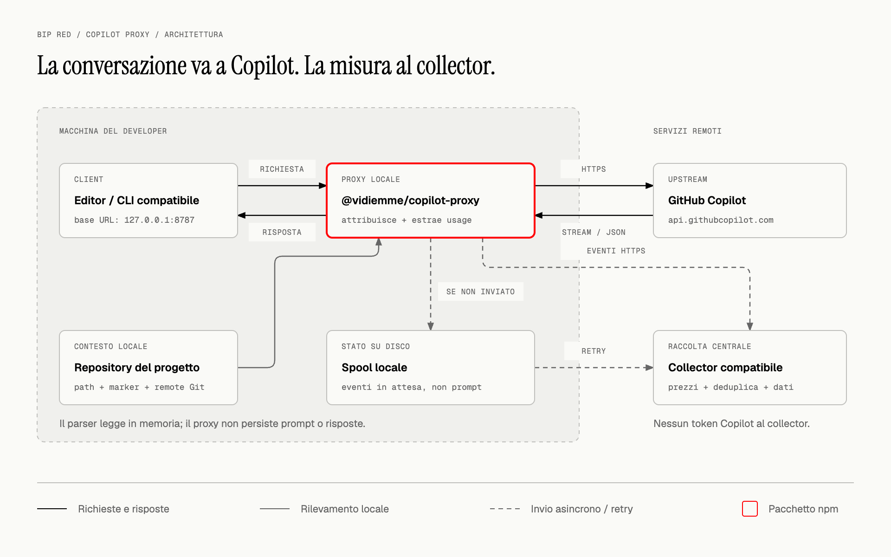
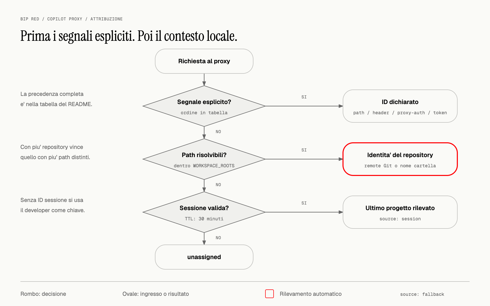

# @vidiemme/copilot-proxy

[](https://www.npmjs.com/package/@vidiemme/copilot-proxy)
[](https://nodejs.org/)
[](https://github.com/vidiemme/copilot-usage/blob/main/packages/client/LICENSE)

**Misura i token di GitHub Copilot e attribuiscili al progetto, non solo alla persona.**

Un proxy locale per chat e agenti: inoltra le richieste a Copilot, estrae i contatori
dalle risposte e invia gli eventi a un collector centrale. Il collector applica il
listino e conserva i dati, permettendo di aggregare il consumo di un progetto tra
piu' developer.

Non e' un'estensione da installare nel marketplace, non fornisce un abbonamento
Copilot e non calcola prezzi sul client. Serve un **collector compatibile**:
il pacchetto contiene i default aziendali Vidiemme, ma puo' usare un altro endpoint.

## Indice

- [Requisiti e compatibilita'](#requisiti-e-compatibilita)
- [Installazione rapida](#installazione-rapida)
- [Come funziona](#come-funziona)
- [Attribuzione al progetto e al developer](#attribuzione-al-progetto-e-al-developer)
- [Configurare editor, CLI e harness](#configurare-editor-cli-e-harness)
- [Comandi e configurazione](#comandi-e-configurazione)
- [Dati, privacy e limiti](#dati-privacy-e-limiti)
- [Diagnostica](#diagnostica)
- [Aggiornamento e rimozione](#aggiornamento-e-rimozione)
- [Sorgenti e licenza](#sorgenti-e-licenza)

## Requisiti e compatibilita'

- **Node.js >= 22.19** (richiesto da Undici 8) e npm.
- Accesso a GitHub Copilot gia' funzionante nel client utilizzato.
- URL di ingest e token del collector. Per Vidiemme chiedi il token a chi
  amministra il servizio; non e' il token GitHub o Copilot.
- Per il rilevamento automatico, il proxy deve poter leggere i repository locali
  e i loro metadati Git sulla macchina che contiene i path nelle richieste.

| Ambiente | Supporto |
| --- | --- |
| VS Code, Insiders, VSCodium, Cursor, Windsurf, Antigravity | Configurazione automatica delle impostazioni utente per l'estensione GitHub Copilot, dove presente. Non misura gli altri provider AI dell'editor. |
| CLI e harness con base URL o header configurabili | Integrazione manuale; il protocollo e l'autenticazione devono essere compatibili con l'upstream. |
| Proxy intermedi verso Copilot | Supportati se permettono di cambiare l'URL del provider Copilot. |
| JetBrains / Android Studio, Eclipse, Xcode, Visual Studio | Non supportati: nessuna intercettazione TLS / `CONNECT` implementata. |
| macOS | Avvio automatico tramite LaunchAgent `launchd` dell'utente. |
| Linux | Avvio automatico tramite servizio utente `systemd`. |
| Windows | Percorsi e impostazioni editor previsti; `--autostart` non implementato. Rilevamento dei path coperto dai test, da verificare su una postazione reale. |

> Le impostazioni di override di Copilot sono opzioni di **debug non supportate**:
> possono cambiare con gli aggiornamenti dell'estensione. Verifica periodicamente
> il traffico con `status` e `doctor`. Non vengono misurate le code completions
> instradate su endpoint diversi da quello di chat.

## Installazione rapida

### Servizio persistente (consigliato su macOS e Linux)

```bash
npm install -g @vidiemme/copilot-proxy@latest
copilot-proxy setup --vscode --autostart
```

Il setup:

1. chiede il **token di raccolta** senza mostrarlo nel terminale;
2. propone la porta locale `8787` e controlla che sia disponibile;
3. propone nome ed email da `git config`, per riconoscersi nella dashboard;
4. salva la configurazione e aggiorna gli editor installati con `--vscode`;
5. registra e avvia il servizio dell'utente con `--autostart`.

**Riavvia gli editor** dopo il setup. Poi invia una richiesta a Copilot Chat e verifica:

```bash
copilot-proxy status
copilot-proxy doctor
```

Per non inviare nome ed email aggiungi `--anonymous` al setup. Questo mantiene
lo pseudonimo tecnico: non rende anonimo l'intero evento.

L'installazione globale mantiene stabile il percorso del servizio. Il setup con
`npx --autostart` e' possibile, ma il servizio punterebbe alla cache npm:
svuotarla potrebbe impedirne il riavvio. Anche eliminare una versione Node
gestita da nvm, fnm, mise o simili richiede di registrare nuovamente il servizio.

### Senza installazione globale o senza avvio automatico

```bash
npx @vidiemme/copilot-proxy@latest setup --vscode
npx @vidiemme/copilot-proxy@latest start
```

`start` resta in primo piano: lascia il terminale aperto e usa `Ctrl+C` per fermarlo.
Con questa modalita' il proxy va avviato prima di usare gli editor configurati.
Su Windows usa questa modalita' o configura autonomamente l'avvio del processo.

### Un collector diverso da quello aziendale

```bash
copilot-proxy setup --vscode --autostart \
  --collector-url https://collector.example.com/v1/usage \
  --workspace-roots /percorso/ai/repository
```

Il collector deve implementare il contratto pubblico
[`@vidiemme/copilot-usage-contract`](https://www.npmjs.com/package/@vidiemme/copilot-usage-contract).
Non e' incluso in questo pacchetto. Il default Vidiemme e'
`https://copilot-collector.swarm.vidiemme.it/v1/usage`; la ricerca dei repository
e' limitata per default alla home dell'utente.

Per un rollout non interattivo fornisci `COLLECTOR_TOKEN` tramite l'ambiente di
esecuzione o un secret manager. **Non esiste un'opzione `--token`**: evita di
incollare segreti nei comandi, nella cronologia della shell o nei file versionati.

## Come funziona



[Sorgente HTML del diagramma](https://github.com/vidiemme/copilot-usage/blob/main/packages/client/docs/diagrams/architecture.html)

1. L'editor o il CLI invia la richiesta al proxy, in ascolto su `127.0.0.1:8787`.
2. Il proxy determina progetto e developer e inoltra la richiesta all'upstream,
   per default `https://api.githubcopilot.com`.
3. La risposta viene inoltrata al client mentre un parser estrae l'usage.
4. I contatori normalizzati vengono accodati e inviati al collector in batch.
   Il collector, non il proxy, applica prezzi, deduplicazione e persistenza.

Il token Copilot e la conversazione vanno all'upstream, **non al collector**.
Il proxy non effettua login o rinnovo delle credenziali Copilot: se ne occupa
il client o il proxy intermedio gia' utilizzato.

### Protocolli e contatori

| Formato di risposta | Origine dei contatori |
| --- | --- |
| Anthropic Messages | `message_start` e `message_delta`, inclusi cache read e cache write. |
| OpenAI / Copilot Chat Completions | Oggetto `usage` nella risposta JSON o nel chunk finale dello stream. |
| OpenAI Responses API | `response.usage`, anche negli eventi `response.completed`, `response.incomplete` e `response.failed`. |

Per le richieste streaming a `/chat/completions`, il proxy aggiunge
`stream_options: { "include_usage": true }` **solo se `stream_options` e' assente**.
Se il client lo specifica gia', deve richiedere l'usage correttamente.
La Responses API non riceve questo parametro.

Ogni evento distingue `inputTokens`, `cachedInputTokens`, `cacheWriteTokens` e
`outputTokens`, evitando doppi conteggi quando i dettagli del provider lo permettono.
Le risposte senza contatori, per esempio le chiamate a `/models`, non generano eventi.
Se uno stream si interrompe vengono registrati i contatori disponibili: il risultato
puo' essere parziale.

## Attribuzione al progetto e al developer



[Sorgente HTML del diagramma](https://github.com/vidiemme/copilot-usage/blob/main/packages/client/docs/diagrams/attribution.html)

Il progetto viene risolto con questa precedenza:

| Priorita' | Segnale | `projectSource` |
| --- | --- | --- |
| 1 | Prefisso URL `/p/<progetto>` | `path` |
| 2 | Header `X-Project-Id` (nome personalizzabile) | `header` |
| 3 | Username di `Proxy-Authorization: Basic ...`, se inviato dal client | `proxy-auth` |
| 4 | Mappa statica `ATTRIBUTION_TOKENS` | `token` |
| 5 | Path locali citati nella richiesta, dentro `WORKSPACE_ROOTS` | `workspace` |
| 6 | Ultimo progetto rilevato per la stessa sessione, entro il TTL | `session` |
| 7 | `UNASSIGNED_PROJECT`, per default `unassigned` | `fallback` |

Il rilevamento risale dai path al marker piu' vicino (`.git`, `.hg` o `.svn`).
Tra piu' progetti prevale quello con piu' path candidati distinti.
Per Git l'identita' deriva dal remote `origin`, poi `upstream`, poi dal primo
disponibile, non dal nome scelto per la cartella di clone:

| Remote | ID progetto |
| --- | --- |
| `git@github.com:acme/portal.git` | `acme/portal` |
| `https://gitlab.com/acme/web/portal.git` | `acme/web/portal` |
| Nessun remote utilizzabile, oppure progetto non Git | Nome normalizzato della cartella |

Sono gestiti anche worktree e submodule Git. La cache path/repository dura 10 minuti.
L'ID derivato dal remote non include l'host: percorsi uguali su host Git diversi
possono quindi coincidere.

Le richieste senza path riutilizzano il progetto dell'ultima rilevazione della
sessione per **30 minuti**. La sessione usa gli header `vscode-sessionid`,
`x-vscode-session-id`, `x-session-id`, oppure l'ID estratto da `metadata.user_id`.
In loro assenza la chiave e' il developer: in quel caso progetti paralleli
possono condividere il fallback. Il rilevamento ispeziona al massimo i primi
4 MiB del corpo della richiesta.

Il developer viene risolto da `/u/<developer>`, `X-Developer-Id`, credenziali
mappate oppure da un hash SHA-256 con salt, troncato a 16 caratteri esadecimali,
dell'identita' stabile estratta dal token upstream (o del token intero per altri
formati). Senza un segnale utilizzabile risulta `unknown`.
Il salt deve rimanere uguale sulle postazioni per mantenere coerenti gli pseudonimi;
cambiarlo interrompe la continuita' degli ID.

## Configurare editor, CLI e harness

### VS Code e derivati

`setup --vscode` imposta queste due chiavi nelle **impostazioni utente**:

```json
{
  "github.copilot.advanced.debug.overrideCapiUrl": "http://127.0.0.1:8787",
  "github.copilot.advanced.debug.overrideAuthType": "token"
}
```

`"token"` e' una modalita' di autenticazione, non un segreto da sostituire.
Non serve un'impostazione per repository. Non impostare `overrideProxyUrl`:
riguarda un altro endpoint, quello delle code completions.

Il setup salva un backup con suffisso `.bak` prima di modificare un file esistente.
Se il file contiene commenti, virgole finali o non e' JSON valido, non lo riscrive
e stampa lo snippet da inserire manualmente. Poi riavvia l'editor.

### CLI: attribuzione esplicita

Per un client compatibile con l'upstream e con base URL configurabile:

```text
http://127.0.0.1:8787/p/acme-portal
http://127.0.0.1:8787/u/developer-id/p/acme-portal
```

Il client aggiunge il path API, per esempio `/chat/completions` o `/v1/messages`.
I prefissi `/u/` e `/p/` sono opzionali, accettati in qualsiasi ordine e rimossi
prima dell'inoltro. Gli ID espliciti accettano fino a 64 caratteri:
lettere, numeri, punti, trattini e underscore, con primo carattere alfanumerico.
Per un ID che rappresenta un remote con sottogruppi usa uno slug come `acme-portal`,
non slash aggiuntivi nel prefisso.

In alternativa invia gli header `X-Project-Id` e, se serve, `X-Developer-Id`.
Gli header di attribuzione e `Proxy-Authorization` non vengono inoltrati all'upstream.
Il supporto al formato Anthropic **non** traduce automaticamente i protocolli:
un client Anthropic richiede un upstream che esponga Messages, o un traduttore.

### Harness con proxy intermedio

Se usi Claude Code, Codex o altri harness tramite un traduttore/provider Copilot,
la disposizione consigliata e':

```text
harness -> proxy intermedio -> copilot-proxy -> api.githubcopilot.com
```

Nel proxy intermedio cambia l'URL del provider Copilot in `http://127.0.0.1:8787`.
Lascia `UPSTREAM_BASE_URL` del proxy di misura al suo default Copilot.
Il proxy intermedio continua a gestire login, rinnovo token e traduzione;
deve conservare path di contesto o segnali espliciti per attribuire il progetto.
Questa disposizione permette alla stessa istanza di misurare anche VS Code.

`copilot-proxy` e' un **reverse proxy HTTP**, non un forward proxy generico:
impostare soltanto `HTTP_PROXY` / `HTTPS_PROXY` non garantisce il funzionamento.

## Comandi e configurazione

Gli esempi usano il comando globale; in alternativa sostituisci `copilot-proxy`
con `npx @vidiemme/copilot-proxy@latest`.

| Comando | Funzione |
| --- | --- |
| `setup` | Crea la configurazione della postazione. |
| `start` | Avvia il proxy in primo piano (comando predefinito se non ne indichi uno). |
| `status` | Mostra versione installata e in esecuzione, contatori e spool. |
| `doctor` | Controlla configurazione, cartelle, collector, editor, spool e processo. |
| `restart` | Riavvia il servizio automatico gia' registrato. |
| `uninstall` | Rimuove l'avvio automatico; lascia configurazione e impostazioni editor. |
| `--version` | Mostra la versione del CLI. |
| `--help` | Mostra comandi e opzioni. |

### Opzioni di setup

| Opzione | Uso |
| --- | --- |
| `--vscode` | Configura VS Code e derivati installati. |
| `--autostart` | Registra e avvia il servizio utente su macOS/Linux. |
| `--port <n>` | Porta locale, default `8787`. |
| `--workspace-roots <a,b>` | Directory assolute in cui risolvere i progetti. |
| `--collector-url <url>` | Endpoint di ingest, incluso il path `/v1/usage`. |
| `--upstream <url>` | Base URL upstream, default `https://api.githubcopilot.com`. |
| `--name <nome>`, `--email <email>` | Identita' facoltativa per la dashboard. |
| `--anonymous` | Non invia nome ed email. |
| `--salt <valore>` | Sovrascrive il salt aziendale; mantienilo coerente nel team. |
| `--force` | Ripete il setup partendo dal file esistente, token compreso. |

Per cambiare porta senza reinserire il token:

```bash
copilot-proxy setup --force --port 9000 --vscode --autostart
```

### File e variabili d'ambiente

Il file `config.json` usa le stesse chiavi delle variabili d'ambiente.
La precedenza di **`start`** e': opzioni CLI > ambiente non vuoto > file > default
del pacchetto. `start` accetta `--port`, `--log-level`, `--collector-url` e
`--workspace-roots`. Il setup salva le proprie opzioni: non e' un import
generico di tutte le variabili d'ambiente nel file.

| Chiave | Default / significato |
| --- | --- |
| `COLLECTOR_TOKEN` | Obbligatorio; token di ingest, salvato dal setup. |
| `COLLECTOR_URL` | Endpoint Vidiemme indicato sopra; HTTPS obbligatorio fuori da localhost. |
| `HOST`, `PORT` | `127.0.0.1`, `8787`. Mantieni il bind locale. |
| `UPSTREAM_BASE_URL` | `https://api.githubcopilot.com`. |
| `UPSTREAM_AUTH_TOKEN` | Assente; se impostato sostituisce il token inoltrato all'upstream. |
| `WORKSPACE_ROOTS` | Home utente; lista di directory separate da virgole. |
| `PROJECT_MARKERS` | `.git,.hg,.svn`. |
| `PROJECT_HEADER`, `UNASSIGNED_PROJECT` | `x-project-id`, `unassigned`. |
| `PROJECT_STICKY_TTL_MS` | `1800000` (30 minuti). |
| `DEVELOPER_ID_SALT` | Salt aziendale incluso nel pacchetto; non e' una credenziale segreta. |
| `DEVELOPER_NAME`, `DEVELOPER_EMAIL` | Facoltativi; il nome abilita l'invio dell'identita' al collector. |
| `ATTRIBUTION_TOKENS` | `{}`; oggetto JSON token -> `{ "projectId": "...", "developerId": "..." }`. Contiene credenziali: non versionarlo. |
| `FLUSH_INTERVAL_MS`, `FLUSH_MAX_BATCH` | `5000`, `100` (massimo 500 eventi per batch). |
| `COLLECTOR_TIMEOUT_MS` | `10000`. |
| `SPOOL_PATH` | `spool.jsonl` nella directory di configurazione. |
| `LOG_LEVEL` | `info`. |
| `TLS_KEY_PATH`, `TLS_CERT_PATH` | Assenti; impostali entrambi per abilitare HTTPS in ingresso. |

La directory di configurazione e':

- macOS/Linux: `~/.config/copilot-proxy`, oppure `$XDG_CONFIG_HOME/copilot-proxy`;
- Windows: `%APPDATA%/copilot-proxy`, quando `APPDATA` e' definita;
- tutte le piattaforme: `COPILOT_PROXY_HOME`, se impostata nell'ambiente,
  sostituisce l'intera directory.

Il setup crea la directory con permessi `0700` e il file con `0600` su sistemi POSIX.
Non condividere il file: contiene il token di raccolta.
Il servizio automatico legge il file, non eredita in generale l'ambiente della shell;
`COPILOT_PROXY_HOME` viene invece riportata nella definizione del servizio.
Per impostazioni persistenti del servizio usa il file di configurazione.

## Dati, privacy e limiti

**Non vengono persistiti prompt o risposte dal proxy.** Il corpo viene comunque
letto in memoria per inoltro, ispezione e attribuzione. Al collector arrivano:

- ID richiesta e timestamp, progetto e fonte dell'attribuzione;
- identita' del repository rilevato: host, gruppi, nome e URL del remote;
- pseudonimo/ID developer e sua fonte, user agent e ID sessione se disponibile;
- endpoint, modello, contatori di token, durata e indicazione streaming;
- nome ed email facoltativi, negli header di invio, salvo `--anonymous`.

Non vengono inviati al collector il token Copilot, i path di lavoro rilevati o il
contenuto della conversazione. Gli URL dei remote sono invece metadati inviati:
non inserirvi credenziali. Il collector ha una propria gestione dei dati e della
conservazione. Lo pseudonimo e' un identificatore tecnico, **non una garanzia
di anonimato**; il salt distribuito nel pacchetto e' pubblico.

Il token di ingest e' condiviso nell'organizzazione: chi lo possiede puo'
dichiarare progetto e developer. E' uno strumento di contabilita' analitica
interna, non un sistema di attribuzione non ripudiabile o una fattura ufficiale.

### Collector non disponibile

La disponibilita' del collector non blocca le richieste Copilot. Errori di rete,
timeout, errori server e HTTP `401`, `403`, `408`, `429` fanno conservare gli eventi
in uno spool JSONL locale, ritentato ai flush successivi e al riavvio.
La deduplicazione richiede il collector compatibile e usa `requestId`.

La consegna e' **best effort, non senza perdite**:

- coda in memoria fino a 10.000 eventi; quelli nuovi in eccesso sono scartati;
- spool fino a 50.000 eventi, conservando i piu' recenti;
- gli altri errori HTTP 4xx sono definitivi e causano lo scarto del batch;
- gli eventi rifiutati singolarmente dal collector vengono segnalati nei log;
- un arresto improvviso puo' perdere gli eventi ancora soltanto in memoria.

Tieni sotto controllo spool, errori e contatore `dropped`. Il proxy non ha
autenticazione locale propria: non esporre `HOST=0.0.0.0` senza protezioni adeguate.
Se il traffico attraversa la rete, proteggi anche l'ingresso con TLS e controlli
di accesso; non disabilitare la verifica dei certificati.

## Diagnostica

```bash
copilot-proxy --version
copilot-proxy status
copilot-proxy doctor
curl http://127.0.0.1:8787/_health
```

`/_health` restituisce versione, avvio, URL upstream/collector, stato del rilevamento,
statistiche `usage` e `spoolBytes`. I contatori sono **del processo corrente**,
non uno storico completo; `ok: true` non dimostra che il collector sia raggiungibile.

`doctor` esce con codice non zero in presenza di `FAIL`. Un `WARN` da solo non
fa fallire il comando: versione del processo diversa dal CLI, editor non tutti
configurati o assenza prolungata di traffico richiedono comunque attenzione.
Il controllo degli editor resta attivo anche se usi esclusivamente CLI:
in quel caso un `FAIL` sugli editor non dimostra un errore dell'inoltro CLI.

| Sintomo | Verifica / azione |
| --- | --- |
| Copilot non risponde dopo il setup | Verifica che il proxy sia avviato; se devi tornare al collegamento diretto rimuovi le due chiavi di override e riavvia l'editor. |
| Porta occupata | Ripeti il setup con `--force --port 9000 --vscode` e, se usato, `--autostart`. |
| Nessun evento misurato | Riavvia l'editor, controlla gli override e il protocollo di usage; le risposte senza contatori non sono misurabili. |
| Progetti `unassigned` | Controlla `WORKSPACE_ROOTS`, path visibili sulla macchina del proxy e marker; per i CLI usa un prefisso o un header esplicito. |
| Spool in crescita / collector `unreachable` | Controlla rete, URL del collector e log. |
| Collector `401` / `403` | Token ruotato: vedi [Cambiare il token](#cambiare-il-token). Gli eventi restano in attesa entro i limiti dello spool. |
| Processo con versione precedente | Dopo l'aggiornamento del pacchetto esegui `restart`. |
| Servizio non riparte dopo pulizia cache o cambio Node | Reinstalla globalmente e ripeti `setup --force --autostart`. |

Su macOS il servizio scrive stdout e stderr in `proxy.log` nella directory
di configurazione. Su Linux usa `journalctl --user -u copilot-proxy.service`.
In primo piano i log sono nel terminale.

## Aggiornamento e rimozione

### Aggiornare

```bash
npm install -g @vidiemme/copilot-proxy@latest
copilot-proxy restart
copilot-proxy doctor
```

`restart` richiede un servizio gia' installato. Se usi `start` in primo piano,
ferma e rilancia il processo. Se passi da `npx` all'installazione globale,
o cambia il percorso di Node, registra nuovamente il servizio:

```bash
copilot-proxy setup --force --vscode --autostart
```

### Cambiare il token

`setup --force` riusa il token gia' salvato e non lo richiede. Per sostituirlo,
impostalo nell'ambiente senza scriverlo nella cronologia della shell:

```bash
read -rs COLLECTOR_TOKEN && export COLLECTOR_TOKEN
copilot-proxy setup --force --vscode --autostart
unset COLLECTOR_TOKEN
```

Senza avvio automatico, ometti `--autostart` e riavvia il processo `start`.

### Disattivare e rimuovere

1. Rimuovi dalle impostazioni utente degli editor
   `github.copilot.advanced.debug.overrideCapiUrl` e
   `github.copilot.advanced.debug.overrideAuthType`, poi riavvia gli editor.
2. Rimuovi anche le base URL e gli header del proxy configurati nei CLI/harness.
3. Esegui `copilot-proxy uninstall` per rimuovere il servizio automatico,
   oppure ferma con `Ctrl+C` il processo avviato a mano.
4. Se installato globalmente: `npm uninstall -g @vidiemme/copilot-proxy`.

`uninstall` **non** elimina configurazione, token, log o spool e non ripristina
le impostazioni editor. Prima di cancellare manualmente i dati locali verifica
che gli eventi in attesa siano stati consegnati. Non fermare semplicemente
il proxy lasciando gli editor configurati: Copilot non raggiungerebbe l'upstream.

## Sorgenti e licenza

- [Codice sorgente e documentazione del progetto](https://github.com/vidiemme/copilot-usage)
- [Segnalazioni e richieste](https://github.com/vidiemme/copilot-usage/issues)
- [Contratto degli eventi](https://github.com/vidiemme/copilot-usage/tree/main/packages/shared)
- [Licenza MIT](https://github.com/vidiemme/copilot-usage/blob/main/packages/client/LICENSE)

I diagrammi sono creati con `diagram-design`, con palette ispirata a
[BIP RED](https://www.bip.red/). PolySans non e' incluso: i sorgenti HTML usano
Instrument Serif, Geist e Geist Mono come fallback dichiarati; i PNG incorporano
la resa dei font per essere leggibili anche su npm senza dipendenze esterne.
